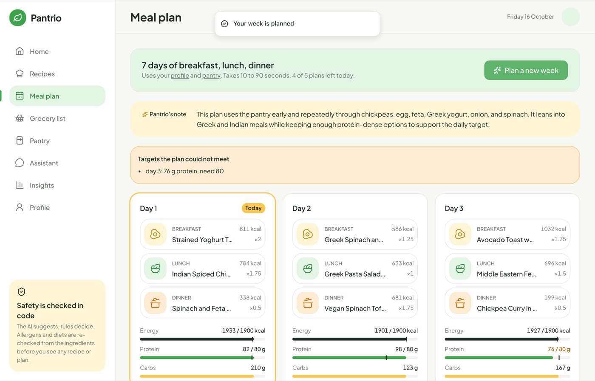
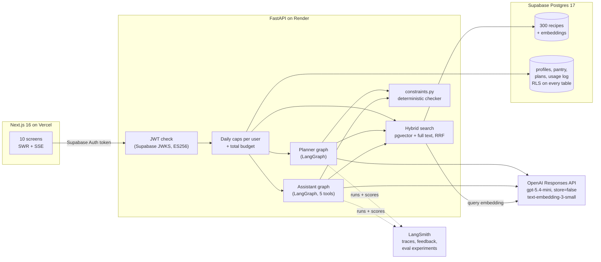
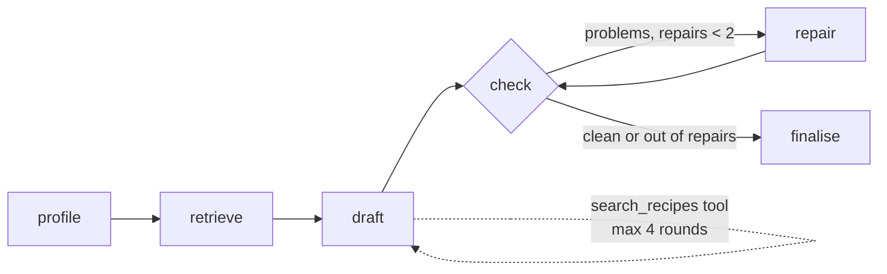
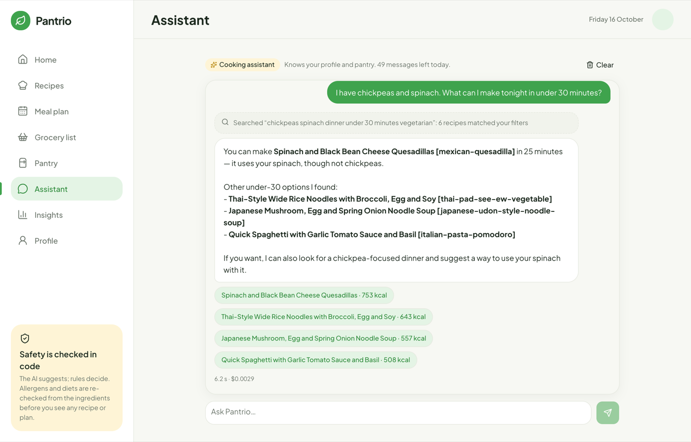
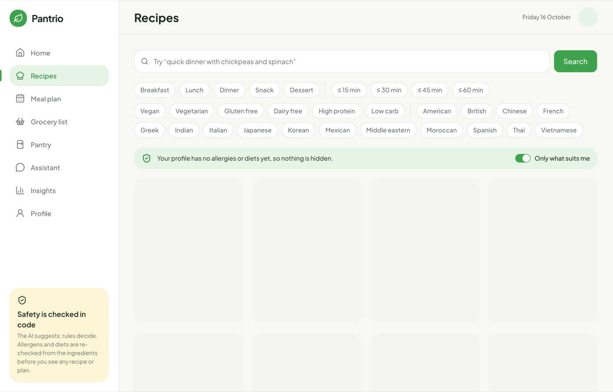
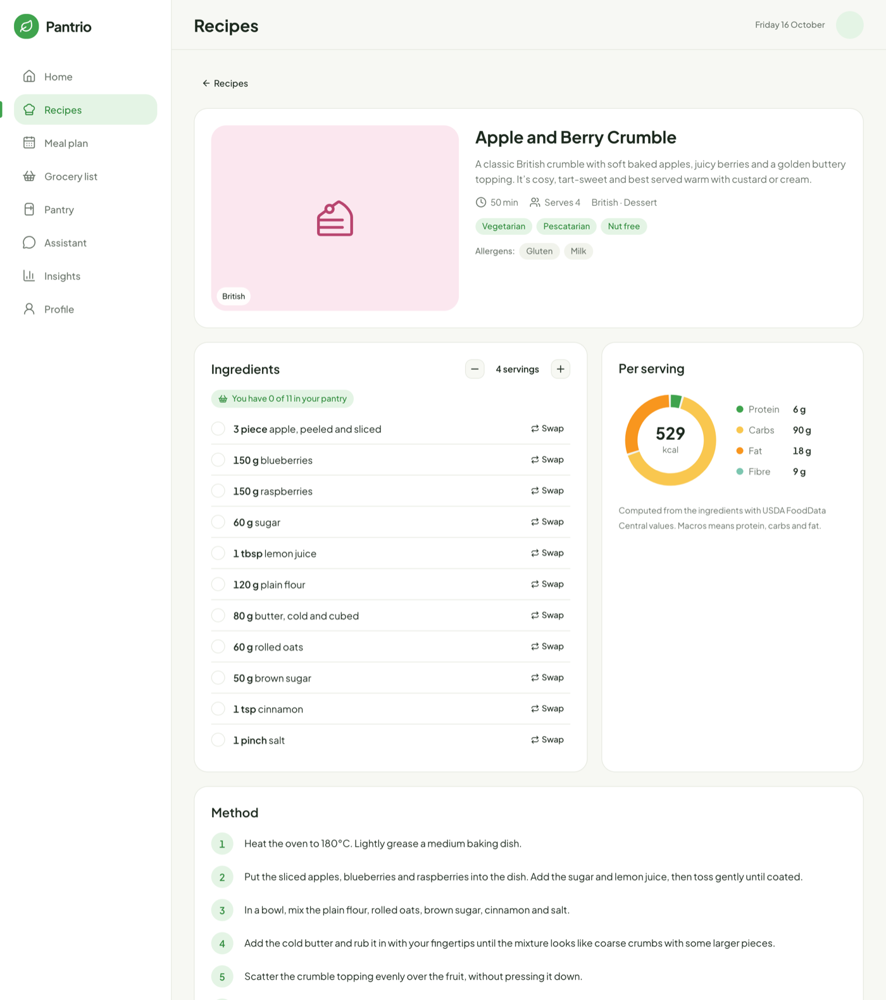
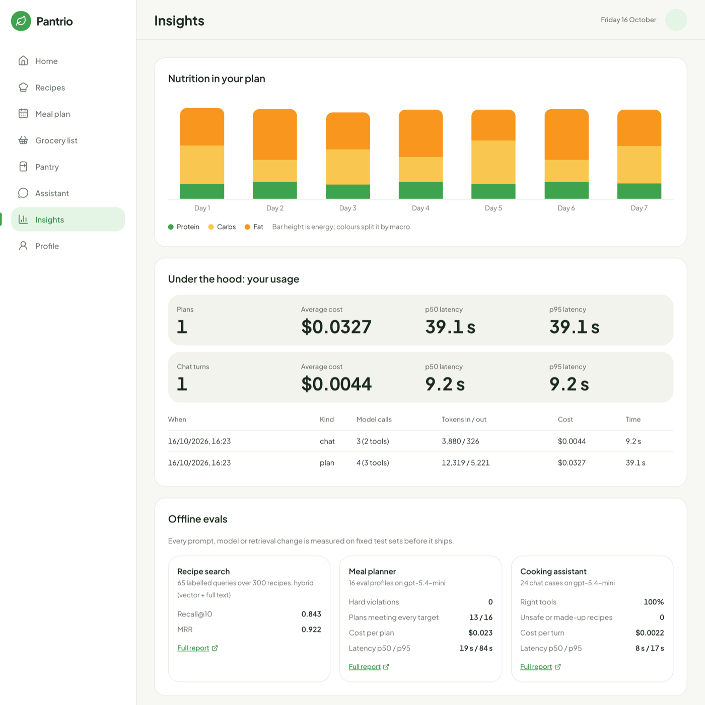

# Pantrio

AI cooking and meal-planning assistant. Tell it what is in your kitchen, your diet, allergies
and nutrition targets; it finds recipes with hybrid RAG search, plans your week with a
LangGraph agent, builds a grocery list from what is missing and answers cooking questions in
a chat. You can add your own recipes from photos, a link or by typing them in. **The model proposes; deterministic code decides.** Every recipe and plan is
re-checked against your allergens and diet before you see it.

**Live demo: https://pantrio-azure.vercel.app** ("Try it as a guest" needs no account. The API
runs on Render's free plan and sleeps when idle, so the first request can take about 50
seconds.) Demo video walkthrough: [`docs/demo-script.md`](docs/demo-script.md).



## Results

All numbers are on `gpt-5.4-mini` (reasoning effort low; medium for recipe import), the
cheapest model that passes the evals. Each figure links to the committed report it comes from.

| What | Eval set | Quality | Cost | Latency p50 / p95 |
|---|---|---|---|---|
| [Recipe search](evals/reports/retrieval-2026-10-15T195536Z.md) | 65 labelled queries, 300 recipes | hybrid recall@10 **0.843** (vector 0.811, full text 0.770), MRR **0.922**, 0 filter violations | embeddings only | 0.57 s / 0.73 s |
| [Meal planner](evals/reports/planner-2026-10-16T084243Z.md) | 16 diet and allergy profiles, 1 to 7 days | **0 hard violations**, 13/16 plans meet every target, protein days 94%, pantry use 94% | **$0.023** per plan | 19 s / 84 s |
| [Cooking assistant](evals/reports/assistant-2026-10-16T094533Z.md) | 24 single-turn cases | right tools **100%**, pantry edits as asked 100%, **0** unsafe or made-up cited recipes | **$0.0022** per turn | 8 s / 17 s |
| [Recipe import](evals/reports/import-2026-10-16T185930Z.md) | 12 labelled recipe pages (JSON-LD, blog text, no recipe, prompt injection) | **0** missed allergens, food matching 99%, servings 100%, injection ignored | **$0.006** per import | 6.5 s / 11.5 s |

- Hybrid search beats either retriever alone. It gains most on allergen queries (0.875
  against 0.741 for vector alone) and ingredient queries (0.911 against 0.824).
- The assistant's first run scored 96% right tools, 50% pantry edits and 1 made-up recipe id.
  A prompt fix and the citation guard brought these to 100%, 100% and 0
  ([before](evals/reports/assistant-2026-10-16T094306Z.md)).
- Recipe import on reasoning effort low missed an allergen in 2 of 12 drafts
  ([before](evals/reports/import-2026-10-16T185353Z.md)): curry powder estimated instead of
  matched (losing mustard), and shrimp paste in Thai curry paste. A code safety net (an
  estimated line gains the allergens of any table food it names) fixed the first; medium
  effort fixed the second ([low with the safety net](evals/reports/import-2026-10-16T185756Z.md)
  still missed it once).
- Weakest case: `cutting` (130 g protein in 1600 kcal) meets the protein minimum on 43% of
  days. The plan still comes back, with the missed days listed as warnings.
- Hard rules (allergens, diet, excluded foods, time, meal slot) are never traded away. A plan
  that still breaks one after two repairs gets the meal swapped by code, or the planner
  refuses. The live eval gate fails on any violation.

## Architecture



### The planner graph



1. **Profile**: drop unknown pantry foods, dedupe meal slots.
2. **Retrieve**: hybrid search for each meal slot. Allergies, diets, excluded foods and the
   time limit are SQL `WHERE` clauses, so the model is only ever shown safe recipes.
3. **Draft**: the model picks one recipe id per meal as a structured output (`PlanDraft`). It
   may call `search_recipes`, which applies the same filters, at most 4 times.
4. **Check**: code picks portions (0.5 to 2 servings per meal) to hit the daily energy target.
   Then `constraints.py` checks every rule, re-deriving allergens and diets from the
   ingredients instead of trusting tags.
5. **Repair**: problems go back to the model in plain words, up to twice.
6. **Finalise**: any meal still breaking a hard rule is swapped by code for a safe candidate;
   if none exists the planner raises. Missed nutrition targets come back as warnings.

Progress streams to the browser as server-sent events, one per graph node.

### The assistant graph

`agent -> tools (max 4 rounds) -> guard`. Tools: `search_recipes`, `check_pantry`,
`update_pantry`, `swap_ingredient` (same-weight swaps with nutrition, allergens and diets
re-derived and re-checked) and `scale_recipe`. Replies cite recipes as `[recipe-id]`. The
guard checks every cited id against the person's rules and adds a note for any that breaks
one or does not exist, so a made-up recipe can't reach the user without a warning.

Conversations are saved as threads per user (table `chat_threads`), so each topic keeps its
own context. The server keeps each thread's model history (the last 20 turns) and sends it
with the next message; the browser only says which thread it is in.

| | |
|---|---|
|  |  |
|  |  |

## Design decisions

- **Safety in code, not in the prompt.** Allergens and diets are derived from ingredients
  (a table of 207 foods joined to USDA data), filtered in SQL before retrieval, checked again
  on the final plan and on every recipe the API returns. The model's word is never the
  source of truth.
- **The corpus is generated, then verified.** 300 fixed dish briefs (15 cuisines × 20) go to
  the model as structured outputs. Code converts every quantity to grams, computes
  nutrition from USDA FoodData Central (SR Legacy, public domain) and rejects any recipe
  whose stated allergens disagree with the derived ones.
- **Hybrid retrieval with reciprocal rank fusion.** Vector search handles vague queries
  ("something cosy for a cold night"). Full text handles exact ingredients and dish names.
  RRF (k = 60) merges the two rankings without tuning score scales.
- **Portions are arithmetic, not generation.** The model picks dishes; code scales each
  between 0.5 and 2 servings to hit the energy target; mean daily kcal error in the planner
  eval is 0%.
- **Cheapest model that passes.** `gpt-5.4-mini` with reasoning effort low. Any change to a
  prompt, schema, tool, retrieval setting or model needs a before/after eval run.
- **Cost guards for a public demo.** Guests sign in anonymously. Each user gets 5 plans and
  50 chat turns a day, and a total daily budget caps the spend across everyone. Every paid
  call is logged with tokens, cost and latency (the Insights page).
- **Your recipes, checked like ours.** Imports (a photo, a web page's schema.org data or its
  text) come back as a draft you review; nothing is saved first. Each ingredient maps to the
  food table, so nutrition and allergens are computed in code. A food the table lacks gets a
  model estimate, marked "Estimated" in the UI, with allergens you can correct. Links are
  fetched with SSRF guards (public addresses only, every redirect re-checked). Your recipes
  stay in your cookbook and never go into meal plans.
- **No data retention at OpenAI.** Every Responses API call uses `store=False`, and tool
  loops are capped.

## Observability

With `LANGSMITH_TRACING=true` every plan and chat turn is one LangSmith trace. The root run is
named `plan` or `chat` and tagged with where it ran (`api`, `cli`, `eval`), with the model in
the metadata. Each run also gets deterministic feedback scores: `targets_met`, `repairs`,
`fallbacks` and `pantry_use` for plans, and `flagged_citations` for chat turns.

`uv run python scripts/langsmith_dashboard.py` builds a **"Pantrio live"** LangSmith
dashboard from these: requests, spend, cost per request, latency p50/p95, error rate, plan
quality, repairs and the citation guard. By default it shows live API traffic only. The three
eval runners upload datasets and experiments to LangSmith, so model or prompt changes can be
compared side by side.

## Quick start

```bash
uv sync
cp .env.example .env                     # add OPENAI_API_KEY; prices are pre-filled
docker compose up -d db                  # Postgres 16 + pgvector
uv run pantrio db migrate && uv run pantrio db seed
uv run pantrio ingest                    # embed the corpus (about $0.002)
uv run pantrio search "quick vegan dinner with chickpeas" --parse
uv run pantrio plan vegan-high-protein   # a week of meals for an eval profile
uv run pantrio chat                      # the cooking assistant in the terminal

# web app: API on :8000, web on :3000
uv run uvicorn pantrio.api:app --env-file .env --reload
cd web && cp .env.example .env.local && npm ci && npm run dev
```

Tests and evals:

```bash
uv run pytest                            # offline: OpenAI mocked, no network
uv run python -m evals.run_retrieval     # retrieval eval (embeddings only)
uv run python -m evals.run_planner       # planner eval, about $0.40 for 16 profiles
uv run python -m evals.run_assistant     # assistant eval, about $0.05 for 24 cases
uv run python -m evals.run_import        # recipe-import eval, about $0.08 for 12 pages
uv run pytest -m live -s                 # paid evals with pass/fail thresholds
```

CI runs ruff, pytest against Postgres 16 + pgvector, and the web lint, typecheck and build.
The paid evals are a manual GitHub Actions workflow.

## Repository

| Path | What |
|---|---|
| `src/pantrio/schema.py` | Pydantic models: recipes, the 14 EU allergens, diets, profiles, plans |
| `src/pantrio/foods.py`, `nutrition.py` | Ingredient table, unit conversion, USDA nutrition, allergen and diet derivation |
| `src/pantrio/corpus.py`, `scripts/generate_corpus.py` | Corpus generation and verification |
| `src/pantrio/search.py`, `embeddings.py` | Hybrid search with SQL safety filters; cached embeddings |
| `src/pantrio/constraints.py` | The deterministic checker: hard rules and soft targets |
| `src/pantrio/planner.py` | Planner graph |
| `src/pantrio/assistant.py`, `swaps.py`, `pantry.py`, `grocery.py` | Assistant graph and its tools |
| `src/pantrio/cookbook.py`, `recipe_import.py` | Your own recipes: derivation, storage, import from photos and links |
| `src/pantrio/api.py`, `auth.py`, `records.py`, `chats.py` | FastAPI app, Supabase token check, saved plans, usage log and chat threads |
| `supabase/migrations/` | SQL migrations (pgvector, full text, RLS) |
| `evals/` | Eval generators, runners, committed reports |
| `web/` | Next.js app ([`web/DESIGN_SYSTEM.md`](web/DESIGN_SYSTEM.md)) |

## Limitations

- High-protein, low-energy profiles (`cutting`) often miss the protein minimum. The corpus
  has few lean, protein-dense dishes, so retrieval can't fix it; more recipes would.
- Vague queries are the weakest retrieval kind (recall@10 0.55). A query rewriter
  (`--parse`) exists but is off in the evals.
- Nutrition is computed from ingredient weights and USDA averages. It is an estimate, not
  medical advice.
- Some recipe sites block bots (Allrecipes answers 402/403), so link import fails there; the
  app suggests a screenshot instead. The import eval covers web pages only; photos were
  checked by hand.
- Estimated foods are a best guess. Check the label of anything you buy.
- Render's free plan sleeps when idle, so the first request after a pause is slow.

"Macros" means protein, carbs and fat; "kcal" is food energy (calories).
