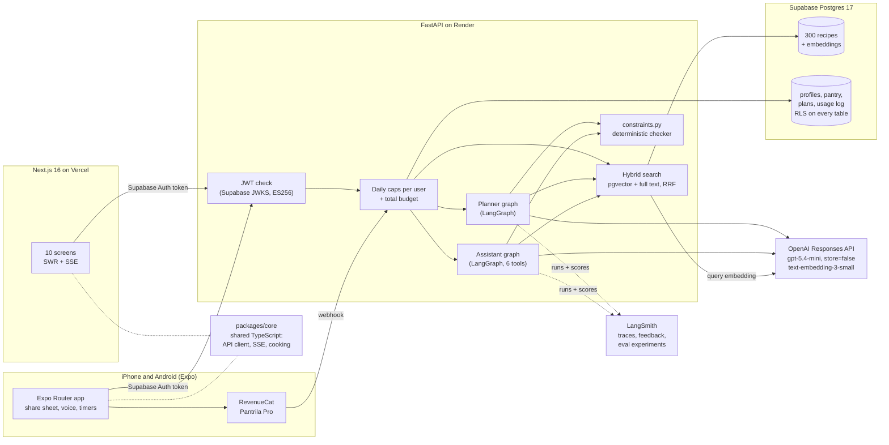
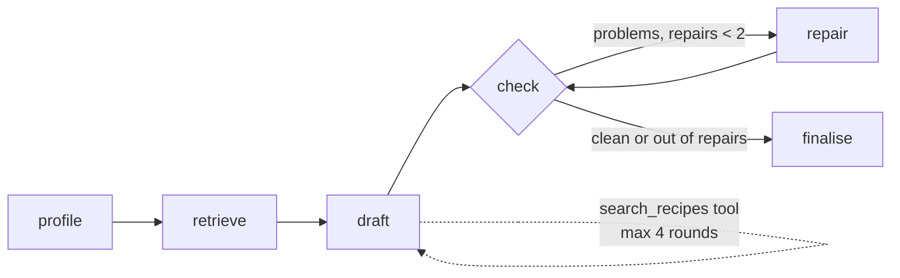

# Pantrila

AI cooking and meal-planning assistant. Tell it what is in your kitchen, your diet, allergies
and nutrition targets; it finds recipes with hybrid RAG search, plans your week with a
LangGraph agent, builds a grocery list from what is missing and answers cooking questions in
a chat. You can add your own recipes from photos, a link, a TikTok, Instagram or Facebook post
or by typing them in, and cook any
recipe in cooking mode. It runs in the browser and as an iPhone and Android app. **The model proposes; deterministic code decides.** Every recipe and plan is
re-checked against your allergens and diet before you see it.

**Live demo: https://app.pantrila.com** ("Continue with Google" keeps your data; "Try it as a guest" needs no account, and a guest
can add Google later without losing anything. The API
runs on Render's free plan and sleeps when idle, so the first request can take about 50
seconds.) Demo video walkthrough: [`docs/demo-script.md`](docs/demo-script.md).


## Results

All numbers are on `gpt-5.4-mini` (reasoning effort low; medium for recipe import), the
cheapest model that passes the evals. Each figure links to the committed report it comes from.

| What | Eval set | Quality | Cost | Latency p50 / p95 |
|---|---|---|---|---|
| [Recipe search](evals/reports/retrieval-2026-10-15T195536Z.md) | 65 labelled queries, 300 recipes | hybrid normalized recall@10 **0.843** (vector 0.811, full text 0.770), MRR **0.922**, 0 filter violations | embeddings only | 0.57 s / 0.73 s |
| [Meal planner](evals/reports/planner-2026-10-16T084243Z.md) | 16 diet and allergy profiles, 1 to 7 days | **0 hard violations**, 13/16 plans meet every target, protein days 94%, pantry use 94% | **$0.023** per plan | 19 s / 84 s |
| [Cooking assistant](evals/reports/assistant-2026-10-19T132325Z.md) | 28 single-turn cases | right tools **100%**, pantry edits as asked 100%, expected draft decisions 3/4, **0** missing draft warnings or unsafe/made-up citations | **$0.0037** per turn | 4.7 s / 8.0 s |
| [Recipe import](evals/reports/import-2026-10-16T185930Z.md) | 12 labelled recipe pages (JSON-LD, blog text, no recipe, prompt injection) | **0** missed allergens, food matching 99%, servings 100%, injection ignored | **$0.006** per import | 6.5 s / 11.5 s |

- Hybrid search beats either retriever alone. It gains most on allergen queries (0.875
  against 0.741 for vector alone) and ingredient queries (0.911 against 0.824).
- The assistant's first run scored 96% right tools, 50% pantry edits and 1 made-up recipe id.
  A prompt fix and the citation guard brought these to 100%, 100% and 0
  ([before](evals/reports/assistant-2026-10-16T094306Z.md)).
- Recipe import on reasoning effort low missed an allergen in 2 of 12 drafts
  ([before](evals/reports/import-2026-10-16T185353Z.md)): curry powder estimated instead of
  matched (losing mustard), and shrimp paste in Thai curry paste. A code safety net (an
  estimated line gains the allergens of any table food it names) fixed the first; medium
  effort fixed the second ([low with the safety net](evals/reports/import-2026-10-16T185756Z.md)
  still missed it once).
- Weakest case: `cutting` (130 g protein in 1600 kcal) meets the protein minimum on 43% of
  days. The plan still comes back, with the missed days listed as warnings.
- Hard rules (allergens, diet, excluded foods, time, meal slot) are never traded away. A plan
  that still breaks one after two repairs gets the meal swapped by code, or the planner
  refuses. The live eval gate fails on any violation.

## Architecture



### The planner graph



1. **Profile**: drop unknown pantry foods, dedupe meal slots.
2. **Retrieve**: hybrid search for each meal slot. Allergies, diets, excluded foods and the
   time limit are SQL `WHERE` clauses, so the model is only ever shown safe recipes.
3. **Draft**: the model picks one recipe id per meal as a structured output (`PlanDraft`). It
   may call `search_recipes`, which applies the same filters, at most 4 times.
4. **Check**: code picks portions (0.5 to 2 servings per meal) to hit the daily energy target.
   Then `constraints.py` checks every rule, re-deriving allergens and diets from the
   ingredients instead of trusting tags.
5. **Repair**: problems go back to the model in plain words, up to twice.
6. **Finalise**: any meal still breaking a hard rule is swapped by code for a safe candidate;
   if none exists the planner raises. Missed nutrition targets come back as warnings.

Progress streams to the browser as server-sent events, one per graph node.

### The assistant graph

`agent -> tools (max 4 rounds) -> guard`. Tools: `search_recipes`, `check_pantry`,
`update_pantry`, `swap_ingredient` (same-weight swaps with nutrition, allergens and diets
re-derived and re-checked), `scale_recipe`, and `write_recipe` (a draft for the cookbook
review form). Replies cite corpus recipes as `[recipe-id]`. The
guard checks every cited id against the person's rules and adds a note for any that breaks
one or does not exist, so a made-up recipe can't reach the user without a warning.

Written drafts are checked independently after the model answers. Rule violations and unchecked
ingredients are returned as structured warnings and displayed beside the save action.

Conversations are saved as threads per user (table `chat_threads`), so each topic keeps its
own context. The server keeps each thread's model history (the last 20 messages) and sends it
with the next message; the browser only says which thread it is in.

| | |
|---|---|
|  |  |
|  |  |

## Phone apps

`mobile/` is the iPhone and Android app, built with Expo (React Native) on the same API and Supabase
sign-in as the web app, so one account works everywhere. The code both apps share (API types and client,
the server-sent events reader, amounts, cooking timers, voice commands, plan and grocery helpers) lives in
`packages/core`, with its own unit tests. What the phone adds:

- **Share to Pantrila**: a recipe reel, post, page, text or photos shared from any app becomes an import
  (an iOS share extension and Android intent filters).
- **Cooking mode on the phone**: the screen stays on, timers ring through local notifications with the
  phone locked, and voice commands use on-device speech recognition where the phone has it.
- **Free and Pantrila Pro**: Free has 1 plan a week, 5 imports a month and 10 assistant messages a day;
  Pro (€4.99 a month or €29.99 a year, 7-day trial) is sold in the stores through RevenueCat. The API
  decides what each tier allows: a RevenueCat webhook records the subscription, and the app only sells it.
- **Releases**: EAS Build makes the store builds, Maestro flows drive a real build on EAS (guest sign-in,
  search, cooking, a plan, an import) and take the store screenshots, and EAS Update ships JavaScript-only
  fixes to store builds whose native code matches (fingerprint runtime versions).

Build steps, the PR-by-PR plan and the owner's store tasks: [`docs/plans/mobile-app.md`](docs/plans/mobile-app.md),
[`mobile/README.md`](mobile/README.md) and [`docs/store-listing.md`](docs/store-listing.md).

## Design decisions

- **Safety in code, not in the prompt.** Allergens and diets are derived from ingredients
  (a table of 218 foods joined to USDA and Ciqual data), filtered in SQL before retrieval, checked again
  on the final plan and on every recipe the API returns. The model's word is never the
  source of truth.
- **The corpus is generated, then verified.** 300 fixed dish briefs (15 cuisines × 20) go to
  the model as structured outputs. Code converts every quantity to grams, computes
  nutrition from USDA FoodData Central (SR Legacy, public domain) and reviewed Ciqual additions and rejects any recipe
  whose stated allergens disagree with the derived ones.
- **Hybrid retrieval with reciprocal rank fusion.** Vector search handles vague queries
  ("something cosy for a cold night"). Full text handles exact ingredients and dish names.
  RRF (k = 60) merges the two rankings without tuning score scales.
- **Portions are arithmetic, not generation.** The model picks dishes; code scales each
  between 0.5 and 2 servings to hit the energy target; mean daily kcal error in the planner
  eval is 0%.
- **Cheapest model that passes.** `gpt-5.4-mini` with reasoning effort low. Any change to a
  prompt, schema, tool, retrieval setting or model needs a before/after eval run.
- **Cost guards for a public demo.** Guests sign in anonymously and can link Google
  to keep the same account ([`docs/google-sign-in.md`](docs/google-sign-in.md)). Each user gets 5 plans and
  50 chat turns a day; searches are also metered. A shared daily budget includes reservations
  for in-flight work, then reconciles actual cost. Reservation sizes are estimates rather than
  provider billing ceilings. Every paid call is logged with tokens, cost and latency (the Insights page).
- **Your recipes, checked like ours.** Imports (a photo, a web page's schema.org data or its
  text, or a social post's caption and video read from its link) come back as a draft you
  review; nothing is saved first. Each ingredient maps to the
  food table, so nutrition and allergens are computed in code. A food the table lacks gets a
  model estimate, marked "Estimated" in the UI, with allergens you can correct. Links are
  fetched with SSRF guards (public addresses only, every redirect re-checked). Your recipes
  stay in your cookbook and never go into meal plans.
- **Recipes from posts, credited.** For a TikTok, Instagram or Facebook post, Pantrila reads
  its caption, a recipe site it links to, or the post's video when the method is only there.
  Media is discarded after reading. If a post cannot be read, paste its caption/text or add
  screenshots. The recipe keeps the post link and the creator's @handle.
- **Photos that show the recipe, not a stock dish.** Saving a new cookbook recipe automatically
  generates its photo; a photo failure or exhausted allowance still keeps the saved recipe.
  Photos are made at 4:3 from
  `gpt-image-2.5-flare`, prompted with the recipe's own ingredients and final step: garnish
  and background props may only come from that list (no parsley on a recipe without parsley,
  no bread beside a gluten-free dish), in one fixed scene so the grid looks consistent. All
  300 cost $4.15 ($0.014 each, p50 14.5 s); you can make one for your own recipes too.
  Images live in Supabase Storage; the database keeps paths only.
- **Cooking mode for the moment you need the recipe.** One step at a time in large type,
  ingredients to tick off, timers read from the step text in code ("simmer for 10 to 12
  minutes" offers a 10-minute timer), and a screen wake lock so the phone stays on. Progress
  stays in the browser for 12 hours. "I cooked this" logs the cook and, unless you turn it
  off, takes the amounts used out of your pantry (shown first), so the grocery list stays
  right. No model call is involved.
- **Response storage disabled in requests.** Every Responses API call uses `store=False`, and tool
  loops are capped.

## Observability

With `LANGSMITH_TRACING=true` every plan and chat turn is one LangSmith trace. The root run is
named `plan` or `chat` and tagged with where it ran (`api`, `cli`, `eval`), with the model in
the metadata. Each run also gets deterministic feedback scores: `targets_met`, `repairs`,
`fallbacks` and `pantry_use` for plans, and `flagged_citations` for chat turns.

`uv run python scripts/langsmith_dashboard.py` builds a **"Pantrila live"** LangSmith
dashboard from these: requests, spend, cost per request, latency p50/p95, error rate, plan
quality, repairs and the citation guard. By default it shows live API traffic only. The three
eval runners upload datasets and experiments to LangSmith, so model or prompt changes can be
compared side by side.

## Quick start

```bash
uv sync
cp .env.example .env                     # add OPENAI_API_KEY; prices are pre-filled
docker compose up -d db                  # Postgres 16 + pgvector
uv run pantrila db migrate && uv run pantrila db seed
uv run pantrila ingest                    # embed the corpus (about $0.002)
uv run pantrila search "quick vegan dinner with chickpeas" --parse
uv run pantrila plan vegan-high-protein   # a week of meals for an eval profile
uv run pantrila chat                      # the cooking assistant in the terminal

# web app: API on :8000, web on :3000
uv run uvicorn pantrila.api:app --env-file .env --reload
npm ci && cd web && cp .env.example .env.local && npm run dev   # one install at the root (npm workspaces)

# phone app: in the Pantrila development build (mobile/README.md), not Expo Go
cd mobile && cp .env.example .env.local && npx expo start
```

Tests and evals:

```bash
uv run pytest                            # offline: OpenAI mocked, no network
uv run python -m evals.run_retrieval     # retrieval eval (embeddings only)
uv run python -m evals.run_planner       # planner eval, about $0.40 for 16 profiles
uv run python -m evals.run_assistant     # assistant eval, about $0.05 for 24 cases
uv run python -m evals.run_import        # recipe-import eval, 12 pages + 13 captions
uv run python -m evals.video_audio       # once: text-to-speech audio for the video eval (committed)
uv run python -m evals.run_video [--plain]   # video-import eval, 6 spoken cooking videos
uv run pytest -m live -s                 # paid evals with pass/fail thresholds
```

CI runs ruff, pytest against Postgres 16 + pgvector, the shared-core tests, the web lint, typecheck and
build, the phone app's lint, typecheck, Jest tests and `expo-doctor`, and the landing site's build.
The paid evals are a manual GitHub Actions workflow.

## Repository

| Path | What |
|---|---|
| `src/pantrila/schema.py` | Pydantic models: recipes, the 14 EU allergens, diets, profiles, plans |
| `src/pantrila/foods.py`, `nutrition.py` | Ingredient table, unit conversion, USDA/Ciqual nutrition, allergen and diet derivation |
| `src/pantrila/corpus.py`, `scripts/generate_corpus.py` | Corpus generation and verification |
| `src/pantrila/search.py`, `embeddings.py` | Hybrid search with SQL safety filters; cached embeddings |
| `src/pantrila/constraints.py` | The deterministic checker: hard rules and soft targets |
| `src/pantrila/planner.py` | Planner graph |
| `src/pantrila/assistant.py`, `swaps.py`, `pantry.py`, `grocery.py` | Assistant graph and its tools |
| `src/pantrila/meal_swap.py`, `web/src/components/swap-meal.tsx` | Swap one meal of a saved plan for another recipe that passes your rules (no model call) |
| `src/pantrila/cookbook.py`, `recipe_import.py`, `social.py` | Your own recipes: derivation, storage, import from photos, links, post captions, video sound and pasted text |
| `src/pantrila/photos.py` | Recipe photo prompt, generation and Supabase Storage |
| `src/pantrila/cooking.py`, `web/src/components/cooking-mode.tsx` | Cooking mode: pantry use after "I cooked this", step timers, wake lock |
| `src/pantrila/api.py`, `api_models.py`, `api_views.py`, `backend.py` | FastAPI routes, HTTP models, response views and pooled persistence |
| `src/pantrila/auth.py`, `records.py`, `chats.py`, `operations.py` | Token checks, saved records, conversations and atomic paid-operation lifecycle |
| `supabase/migrations/` | SQL migrations (pgvector, full text, RLS) |
| `evals/` | Eval generators, runners, committed reports |
| `web/` | Next.js app ([`web/DESIGN_SYSTEM.md`](web/DESIGN_SYSTEM.md)) |
| `mobile/` | Expo app for iPhone and Android ([`mobile/README.md`](mobile/README.md)); Maestro flows in `mobile/.maestro/` |
| `packages/core/` | TypeScript shared by the web and phone apps (`@pantrila/core/<module>`) |
| `src/pantrila/entitlements.py`, `analytics.py` | Pantrila Pro from the RevenueCat webhook; PostHog funnel events |
| `site/` | The pantrila.com landing site |

## Limitations

- The assistant can choose a new draft even when a related corpus recipe exists. In the
  latest 28-case run, draft/corpus decisions passed 3/4 cases and existing-recipe citations
  appeared in 9/11 expected cases. Safety warnings are enforced separately in code.

- High-protein, low-energy profiles (`cutting`) often miss the protein minimum. The corpus
  has few lean, protein-dense dishes, so retrieval can't fix it; more recipes would.
- Vague queries are the weakest retrieval kind (normalized recall@10 0.55). A query rewriter
  (`--parse`) exists but is off in the evals.
- Nutrition is computed from ingredient weights and USDA/Ciqual averages (see [data conventions](docs/nutrition-data.md)). It is an estimate, not
  medical advice.
- Imported recipes estimate missing amounts and unsupported measures such as herb sprigs.
  Estimated nutrition and ingredient assumptions remain visible after saving. A repeated
  reference such as "cooked pasta" is counted once; explicit extra amounts are preserved.
- Some recipe sites block bots (Allrecipes answers 402/403), so link import fails there; the
  app suggests a screenshot instead. The import eval covers web pages and synthetic captions;
  photos were checked by hand.
- TikTok doesn't share captions with other apps, so for TikTok you paste the caption (the link
  keeps the credit). Instagram and Facebook links work alone today, and if a platform stops
  sharing, the app asks for the caption instead. When the caption (and any recipe site it
  links) has no method, Pantrila can hear the video from the link: a third-party scraping
  service (Apify, one actor per platform) finds the post's video (and a TikTok caption), and
  Pantrila reads its sound and 4 frames in memory and drops it. This goes further against the
  platforms' terms than reading the caption, works only for public posts, can stop working
  whenever a platform changes, costs $0.003-0.006 per post, and is off unless configured
  (capped per person per day). If it cannot read the recipe, paste its text or add screenshots.
  Video uploading is no longer offered. Social imports show an estimated countdown, seeded
  at 105 seconds from recorded 75/103-second imports and adjusted from recent successful
  imports. Vague spoken amounts ("a glug of oil") are estimated and labelled in the draft.
- Estimated foods are a best guess. Check the label of anything you buy.
- Recipe photos are AI-generated and marked as such. The prompt keeps them to the recipe's
  ingredients, but the plating is the model's guess (a steak kebab can come out as kofta).
- Cooking-mode timers find durations written as numbers or simple words ("3 to 4 minutes",
  "1½ hours"); a phrase like "until golden" gets no timer. Timers only ring while the page is
  open, and browsers without the Screen Wake Lock API (or in battery saver) may still dim.
- Render's free plan sleeps when idle, so the first request after a pause is slow.

"Macros" means protein, carbs and fat; "kcal" is food energy (calories).

### Request and conversation limits

The API caps request bodies at 24 MB (including uploads), profile notes at 300 characters,
and recipe steps at 2,000 characters each. Chats retain the latest 200 displayed messages;
model context remains the latest 20 messages. Conflicting writes from two tabs return a
retryable conflict instead of silently replacing conversation history. Saved chat recipe
cards are checked against the current profile whenever the conversation is loaded.


### Updating the Insights evaluation snapshot

Select committed report filenames in `evals/report_selection.json`, then run
`uv run python scripts/update_eval_snapshot.py`. Tests reject a stale generated snapshot.
Retrieval scores use **normalized recall@k**: hits divided by `min(k, relevant_count)`, so
these values are not standard recall over all relevant recipes. Historical reports retain
their original labels and numbers; new runs name the normalized metric explicitly.
